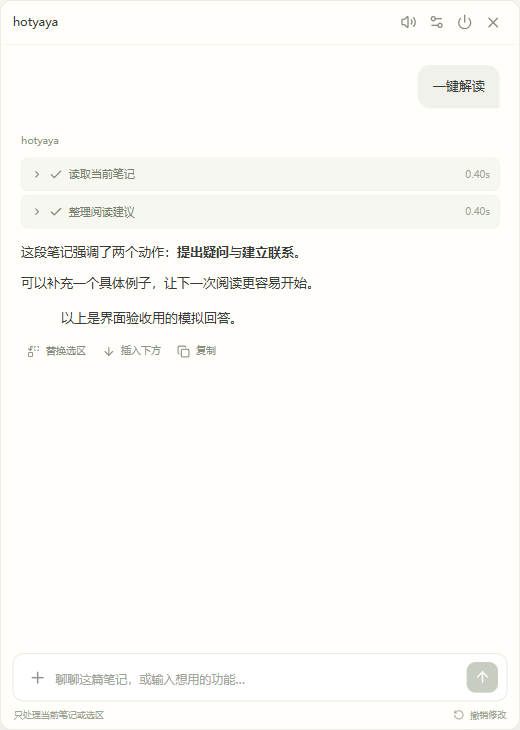
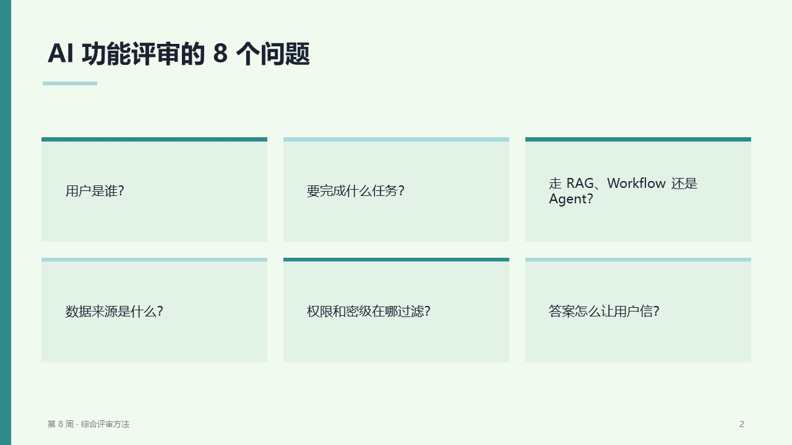
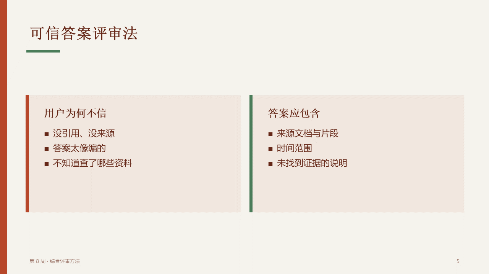
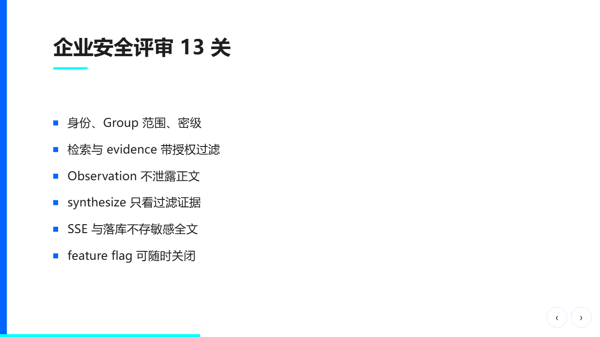
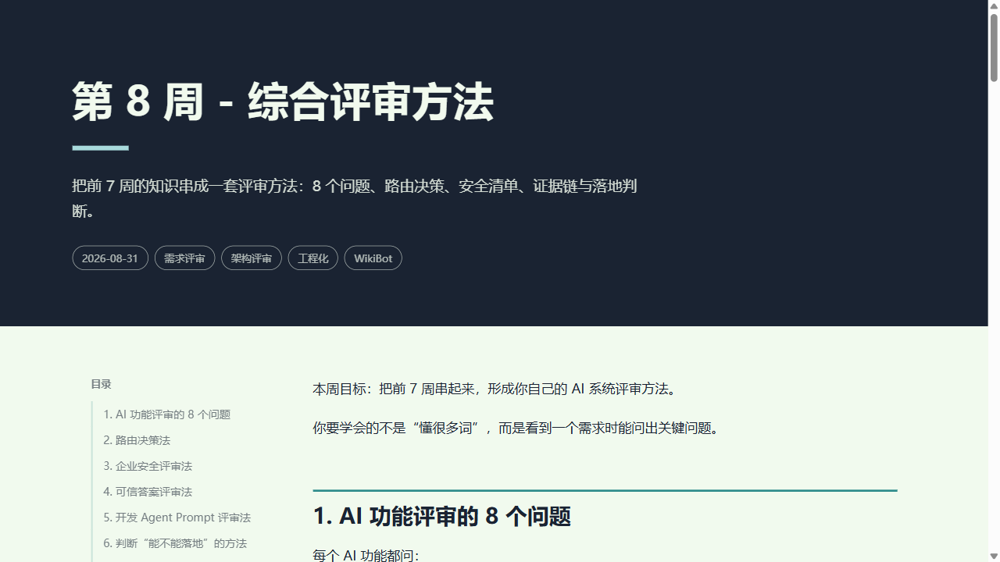
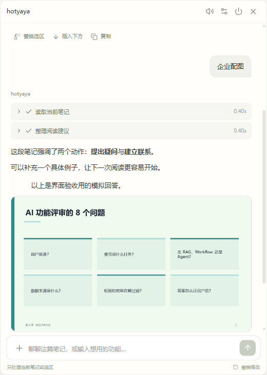

# hotyaya 🦆

**Obsidian 里的 AI 阅读伙伴** — 一只陪你读笔记、帮你写内容、把想法变成幻灯片的小黄鸭。

免费开源。桌面版 Obsidian 1.11.4+。



小黄鸭停在笔记旁边。点击打开聊天窗，选中一段文字，告诉它你想做什么。

---

## 0.3.0 · 住在笔记旁的小伙伴

新增 oneko 云朵猫，保留小黄鸭；素材随插件离线提供。点击宠物聊天，点击爪印或右键打开「宠物小窝」，拖动可移动位置。

- **摸摸、喂点心、抛球、打盹、一起摸鱼**：各有动作和回应；空闲时还会散步、伸懒腰。
- **一起专注**：25 分钟陪伴计时，可随时结束；任务运行期间优先展示工作动作。
- **每个功能都有状态**：阅读、思考、写字、翻译、整理表格、搜索、画图、演示、导出，以及完成和失败反馈。
- **给伙伴取名**：在小窝里保存名字、切换猫/鸭和三种大小。位置、亲密度、陪伴天数和最近 20 条日记保存在插件配置中。
- **轻松陪伴**：不因离开而扣亲密度；安静模式关闭主动气泡；尊重系统「减少动态效果」。互动无需调用模型。

升级前备份 `.obsidian/plugins/md-companion`，复制新包中的插件文件，保留自己的 `data.json`，然后重新加载插件。0.2.0 配置自动补齐宠物设置。

## 它能做什么

### 📖 阅读与对话

| 功能 | 说明 |
|---|---|
| **一键解读** | 把整篇笔记讲清楚，标注不确定的地方 |
| **阅读建议** | 停笔 12 秒后自动给一句简短有用的评论 |
| **自由聊天** | 就当前笔记提问，支持上下文 |

### ✏️ 文字加工

| 功能 | 说明 |
|---|---|
| **自然润色** | 去掉空话套话，保留你的意思和语气（中/英分开处理） |
| **中英互译** | 自动判断方向，保留 Markdown 格式 |
| **生成表格** | 从笔记内容提取结构化表格，一键替换原文 |
| **替换/插入** | 任何结果都可以先预览差异再替换选区或插入下方 |

所有修改都可撤销。笔记被你改过就拒绝应用旧结果，不会覆盖你的新内容。

### 🎨 主题化导出

> 内置 [Anthropic theme-factory](https://github.com/anthropics/skills) 10 套专业配色。模型选主题，程序排版 —— 不可能出现"跳过样式"的裸输出。

**可编辑 PPT**（.pptx，PowerPoint/WPS 直接改文字和形状）

| Ocean Depths | Botanical Garden |
|:---:|:---:|
|  |  |

**HTML 演示稿**（键盘/触屏翻页，16:9 自适应）

| Tech Innovation 封面 | 内容页 |
|:---:|:---:|
|  |  |

**HTML 文章**（你笔记的原文 + 专业排版 + 目录 + 主题色）



### 🖼️ 企业配图

两步生图：先让模型把选区改写成结构化配图方案（类型 × 风格 × 画面元素），再按固定模板拼出完整提示词交给图像接口。



生成后在聊天里直接预览，点击放大。支持保存到笔记同目录、另存为下载、插入选区后。

### 🌐 相关资讯

输入 `/research` 或"搜索相关资讯"，hotyaya 会：
1. 判断笔记类型（学习笔记找教程博客，产品找规格书白皮书）
2. 用 3 组检索词搜索（SearXNG）
3. 解析百度/搜狗跳转链接，过滤无关结果
4. 可选：用本机 Chrome 读取网页正文（Playwright MCP，无界面、独立临时配置）
5. 输出按类型分组的链接清单，每条附一句说明

---

## 安装

### 1. 安装插件

下载 [dist/md-companion-0.3.0.zip](../../releases)，把整个 `md-companion` 文件夹解压到你的库的 `.obsidian/plugins/`。在第三方插件中启用 **hotyaya**。

或者从源码构建：

```bash
git clone https://github.com/Emily-zjy/hotyaya.git
cd hotyaya
npm ci
npm run build
npm run package
# dist/md-companion-0.3.0.zip
```

### 2. 配置模型

打开插件设置：

| 配置项 | 说明 |
|---|---|
| **API 地址** | OpenAI 兼容接口的 Base URL（如公司网关、LiteLLM） |
| **模型名称** | 从服务商控制台复制 |
| **API Key** | 存入 Obsidian SecretStorage，不写进 data.json |

点"测试连接"验证。支持 LiteLLM 网关，自动发现环境变量 `OPENAI_API_KEY` / `LITELLM_API_KEY`。

### 3. 可选功能

| 功能 | 需要配置 | 不配置会怎样 |
|---|---|---|
| **快速模型** | 同一服务中响应更快的模型 ID | 全部使用主模型（推理模型较慢） |
| **SearXNG** | 搜索服务地址 | "相关资讯"不可用 |
| **本机 Chrome** | 已安装 Google Chrome（默认开启） | 用搜索摘要代替网页正文 |
| **图像模型** | 图像 API 地址 + 模型 ID + 密钥 | "企业配图"不可用 |

### 4. 开始使用

1. 打开一篇 `.md` 笔记
2. 点击右上角 ✨ 图标开启辅助器
3. 选中文字，在小黄鸭聊天窗里输入指令

快捷输入：`/pptx` `/slides` `/html` `/image` `/research` `/translate` `/polish` `/table`，或用自然语言（"生成 PPT"、"整理成表格"、"搜索相关资讯"）。

---

## 技术架构

```
┌─────────────────────┐     ┌──────────────────────┐
│   Obsidian Plugin   │────▶│   Node.js Worker     │
│   (React + duck)    │ SSE │   (LangGraph)        │
│                     │◀────│                      │
│  · editor capture   │     │  · skill prompts     │
│  · diff / apply     │     │  · model retry       │
│  · artifact save    │     │  · PPT/HTML render   │
│  · SecretStorage    │     │  · search + browse   │
└─────────────────────┘     └──────────────────────┘
         │                            │
         ▼                            ▼
   .obsidian/plugins/          OpenAI-compatible API
   (data.json, no keys)        (your gateway)
```

- **插件**（浏览器端）：UI、编辑器操作、密钥管理、文件保存。密钥只存在 Obsidian SecretStorage。
- **执行器**（Node.js 子进程）：LangGraph 工作流、模型调用、技能提示词、PPT/HTML 渲染、搜索抓取。仅监听 `127.0.0.1`，每次启动生成随机令牌。
- **通信**：SSE（Server-Sent Events）流式传输步骤、token、产物。

### 模型层可靠性

| 机制 | 参数 |
|---|---|
| 首次响应超时 | 30 秒无任何输出（含推理流）→ 放弃重试 |
| 输出中断超时 | 30 秒无新 token → 放弃重试 |
| 单次上限 | 5 分钟 |
| 重试次数 | 最多 3 次，指数退避 |
| 快速模型兜底 | 配置后最后一次重试改用快速模型 |
| 半截内容处理 | 重试前清除已显示的部分输出 |

### 上游技能（内置）

| 技能 | 来源 | 用途 |
|---|---|---|
| theme-factory | [anthropics/skills](https://github.com/anthropics/skills) (Apache-2.0) | 10 套配色主题，所有 PPT/HTML 输出必须使用 |
| frontend-design | [anthropics/skills](https://github.com/anthropics/skills) (Apache-2.0) | 设计原则 |
| article-illustrator | [baoyu-skills](https://github.com/JimLiu/baoyu-skills) (MIT) | 配图方案类型 × 风格 |
| translate | [baoyu-skills](https://github.com/JimLiu/baoyu-skills) (MIT) | 中英互译 |
| humanizer-zh | [Humanizer-zh](https://github.com/op7418/Humanizer-zh) (MIT) | 中文润色 |
| Fabric patterns | [Fabric](https://github.com/danielmiessler/Fabric) (MIT) | 解读/评论 |
| PPT Master | [ppt-master](https://github.com/hugohe3/ppt-master) (MIT) | 导出参考 |

完整许可证见 [THIRD_PARTY_NOTICES.md](THIRD_PARTY_NOTICES.md)。固定上游提交见 `vendor/manifest.json`。

---

## 安全与隐私

- **密钥不落盘**：API Key 只存 Obsidian SecretStorage / 环境变量，不写入 `data.json`
- **执行器仅本机**：只监听 `127.0.0.1`，每次启动随机令牌，浏览器来源请求一律拒绝
- **笔记数据不出库**：只处理当前打开的 `.md`，任务绑定文件快照；切换笔记或手动编辑后拒绝应用旧结果
- **本机 Chrome 隔离**：无界面、临时独立配置（`--isolated`），不读取你的 Cookie 和登录状态
- **无追踪**：不发送遥测，不请求远程资源（PPT/HTML 生成无外网请求）

---

## 开发

```bash
npm ci           # 安装依赖
npm run typecheck
npm test         # 72 tests
npm run build    # 构建 main.js + worker.cjs
npm run package  # 打包 dist/
```

测试覆盖：模型重试/停机检测、JSON 解析容错、PPT 原生可编辑文字验证、HTML 产物完整性、主题配色推导、配图提示词结构、搜索结果排序、UI 交互（流式/停止/替换/预览/图片缩略图）、密钥不泄漏。

```bash
npx tsx scripts/smoke.ts      # 打包后执行器冒烟测试
node scripts/preview.mjs      # 浏览器 UI 预览（模拟数据）
```

---

## License

MIT
